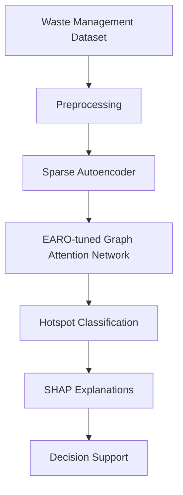

# Explainable AI for Urban Waste Hotspot Detection

An explainable-AI research project exploring how machine learning can identify urban waste hotspots from waste-management data and help inform smarter collection decisions.

> **Research status:** This repository is a documentation scaffold based on the accompanying research paper. The reported metrics below are transcribed from the paper and have **not been independently reproduced in this repository**. Source code, trained weights, and a validated end-to-end route-optimization implementation are not included yet.

## Research question

Can an explainable machine-learning framework use waste-management features to classify urban waste hotspots while making its predictions easier to interpret?

## Reported dataset

The paper describes the Kaggle [Waste Management Dataset](https://www.kaggle.com/datasets/commcollabs/waste-management-dataset/data) as containing 20,000 observations and 48 columns. It describes features related to waste-bin measurements, environmental conditions, traffic, population, land use, road networks, historical collection, and time-related information, with `waste_hotspot_level` as the target.

The dataset is not included in this repository. Please review the dataset's terms and download it from its original source.

## Proposed pipeline

1. **Preprocess data:** impute missing values, filter outliers using the interquartile range (IQR), and apply Min–Max normalization.
2. **Learn representations:** use a Sparse Autoencoder (SAE) to learn compact feature representations.
3. **Classify hotspots:** use a Graph Attention Network (GANet) to model relationships among connected urban locations.
4. **Tune hyperparameters:** use the Enhanced Artificial Rabbits Optimizer (EARO), as described in the paper.
5. **Explain predictions:** use SHAP to estimate feature contributions.

## Results reported in the paper

| Metric | DT+BPSO baseline | Proposed framework |
|---|---:|---:|
| Accuracy | 91.24% | 98.46% |
| Precision | 90.78% | 97.42% |
| Recall | 89.95% | 97.18% |
| F1-score | 90.36% | 97.30% |
| AUC-ROC | 0.93 | 0.98 |
| MCC | 0.87 | 0.95 |

These are **paper-reported results**, not results generated by code in this repository. See [`docs/results.md`](docs/results.md) for interpretation and reproducibility notes.

## SHAP findings reported in the paper

The paper identifies the following as the three most important features for hotspot prediction:

1. Bin fill level
2. Waste weight
3. Overflow count/frequency

These should be verified by reproducing the SHAP analysis before being treated as independently confirmed findings.

## Repository structure

- `docs/methodology.md` — pipeline and methods described in the paper
- `docs/model_architecture.md` — model components and their roles
- `docs/results.md` — paper-reported metrics and evaluation caveats
- `docs/limitations.md` — limitations and recommended next steps
- `data/README.md` — dataset provenance and handling notes
- `src/README.md` — implementation status
- `notebooks/README.md` — planned notebook workflow

## Current implementation status

- [x] Document research objective and proposed architecture
- [x] Record dataset provenance as described in the paper
- [x] Document reported metrics and SHAP findings
- [ ] Add data-loading and validation code
- [ ] Implement preprocessing with a leakage-safe train/test workflow
- [ ] Implement and evaluate a reproducible baseline
- [ ] Implement the proposed model and hyperparameter search
- [ ] Reproduce SHAP plots and document feature attribution
- [ ] Implement route optimization and report route-specific metrics, if this is part of the final scope

## Reproducibility checklist

Before claiming that the published results have been reproduced, document:

- Exact dataset version and checksum
- Feature list and target-label definition
- Train/validation/test split and random seeds
- Preprocessing fitted on training data only
- Graph construction method and edge definitions
- SAE, GANet, and EARO hyperparameters
- Baseline implementation and tuning budget
- Per-class metrics, confusion matrix, and repeated-run variability
- SHAP configuration and feature-attribution plots

## Citation

Pham, Tri Dung. *An Explainable AI Framework for Urban Waste Hotspot Detection and Collection Route Optimization Using Multi-Source Environmental Data.* Research manuscript, 2026.

See [`CITATION.cff`](CITATION.cff) for repository citation metadata.
